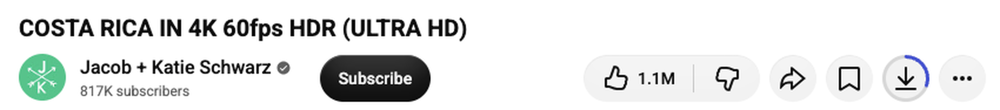
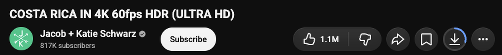
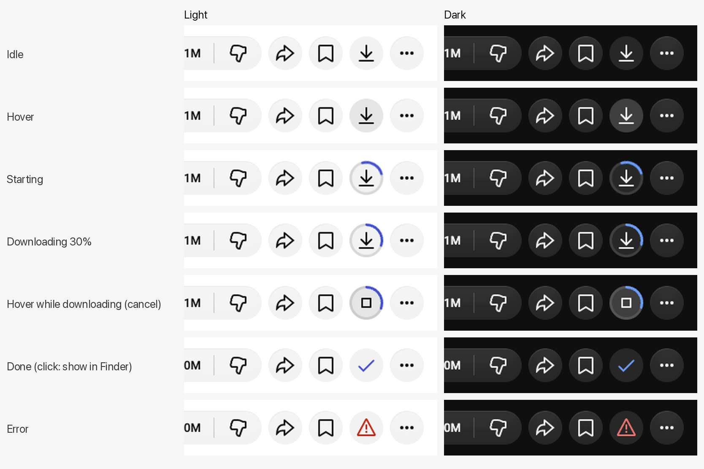

# YouTube Video Downloader

A small Chrome extension that adds one button for downloading any YouTube video in the best available quality.

It blends into YouTube's own interface: it copies the style of its buttons, adds no text labels and follows light and dark theme. It's the sibling of [YouTube Thumbnail Downloader](https://github.com/olafsulich/yt-download-thumbnail-chrome-extension); with both installed, the two buttons sit side by side.

## Screenshots

**Watch page**: at the end of the action row, before the ⋯ menu. A ring around the button shows progress.

**Every state, light and dark**: hover while downloading to cancel; click the check to show the file in Finder.

## What you get

- **Quality:** the best video and the best audio, merged into one `.mp4` (up to 4K, 60fps, HDR when the video has it).
- **File name:** `Video title [videoId].mp4`, saved to your Downloads folder.
- **Shorts:** a button at the top of the action bar.
- **Cancel:** click the button while it downloads. Partial files are removed.

## Install

macOS, Chrome or any Chromium browser (Arc, Brave, Edge).

1. Install the downloader tools: `brew install yt-dlp ffmpeg`
2. Download or clone this repo, and run `./install.sh` in its folder.
3. Open `chrome://extensions` and turn on **Developer mode**.
4. Click **Load unpacked** and select the repo folder.

If you move the folder, run `./install.sh` again.

## How it works

YouTube serves its best quality as separate video and audio streams with scrambled URLs, so an extension can't download it on its own. The button sends the video ID to a small local helper, a Chrome [native messaging host](https://developer.chrome.com/docs/extensions/develop/concepts/native-messaging) in `host/`, which runs [yt-dlp](https://github.com/yt-dlp/yt-dlp) and ffmpeg and reports progress back. `install.sh` registers that helper for this extension only.

## Notes

- AV1 and VP9 video play in Chrome, VLC and IINA, but not in QuickTime, and some video editors can't import them. For an H.264 file, change `-f` in `host/ytvideo_host.py` to `bv*[vcodec^=avc]+ba[acodec^=mp4a]/b`. That usually caps quality at 1080p.
- If downloads start failing, update yt-dlp: `brew upgrade yt-dlp`.

## Development

No build step. The extension is plain JS and CSS in `src/`; the helper is one Python file in `host/`. Changes to the helper apply to the next download; changes to `src/` need a reload in `chrome://extensions`.
